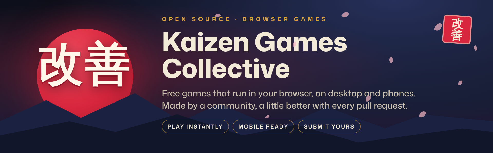

<p align="center">
  
</p>

# Kaizen Games Collective 改善

Free browser games, built in the open. Every game is a plain HTML page, runs on desktop and phones, and is made by a named contributor.

**Play:** https://sarvan-2187.github.io/kaizen-games-collective/

*Kaizen* (改善) means "change for the better". Games here get a little better with every pull request.

## Games

| Game | Genre | By | Mobile |
| --- | --- | --- | --- |
| [Cyber Strike](games/cyber-strike) | 3D arena FPS | [@sarvan-2187](https://github.com/sarvan-2187) | Yes |
| [Stickman Warfare](games/stickman-warfare) | 2D shooter, 30 levels | [@sarvan-2187](https://github.com/sarvan-2187) | Yes |

The live site builds this list automatically from each game's `game.json`, including the credits on the **Makers** section of the home page.

## Submit your game

Two ways, same review:

- **No Git?** Use the [Submit a game form](../../issues/new?template=game_submission.yml): fill it in and attach a `.zip`. A bot checks it and opens the pull request for you.
- **Prefer Git?** Fork and open a pull request:

1. Fork the repo and copy `templates/game-template/` to `games/<your-game-slug>/`.
2. Put your game in `index.html` (extra files like images and audio can sit next to it) and fill in `game.json`.
3. Run `npm run validate` and `npm run preview`, then open a pull request.

Either way a maintainer reviews the code before it goes live, and you are credited as the author. Full rules, the `game.json` fields and the review checklist are in [CONTRIBUTING.md](CONTRIBUTING.md).

## Report a bug

Every game page has a **Report a bug** button and every game card on the home page has a **Report a bug** link. Both open our [bug report form](../../issues/new?template=bug_report.yml) with the game already filled in. Maintainers and the game's authors are notified. You can also [open an issue](../../issues/new/choose) directly.

## Project layout

```
index.html                 Home page (reads games.json at runtime)
assets/fonts/              Mona Sans (SIL Open Font License)
games/<slug>/index.html    One folder per game
games/<slug>/game.json     Name, authors, license, controls, etc.
templates/game-template/   Starter to copy for new games
scripts/                   validate / build / preview / form-submission bot (Node 20+, no dependencies)
.github/                   Issue forms, PR template, CI, CODEOWNERS
docs/                      Maintainer notes
```

## Develop locally

```bash
npm run validate   # check every game's game.json and files
npm test           # tests for the form-submission bot
npm run build      # build the site into _site/
npm run preview    # build, then serve at http://localhost:8080
```

Node 20 or newer is all you need; there is nothing to `npm install`.

On deploy, the build copies the site to `_site/`, writes `games.json`, and adds a small bar (back to the collective, report a bug) to every game page. You don't add this yourself.

## Community

- Be kind: [Code of Conduct](CODE_OF_CONDUCT.md)
- Found a security problem? See [SECURITY.md](SECURITY.md)
- Maintainers: see [docs/MAINTAINING.md](docs/MAINTAINING.md)

## License

The platform code (home page, scripts, workflows) is [MIT](LICENSE). Each game declares its own open-source license in its `game.json`; authors keep the copyright to their games.
